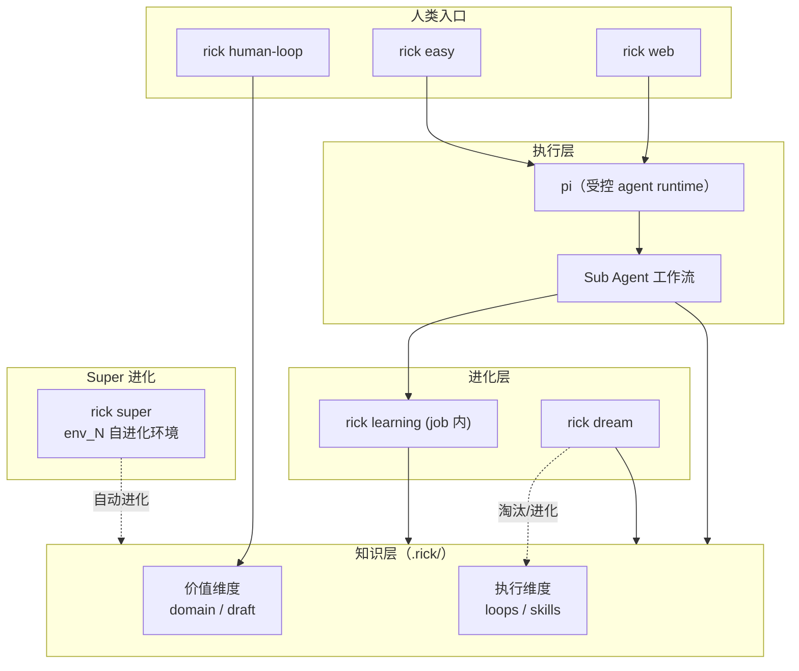
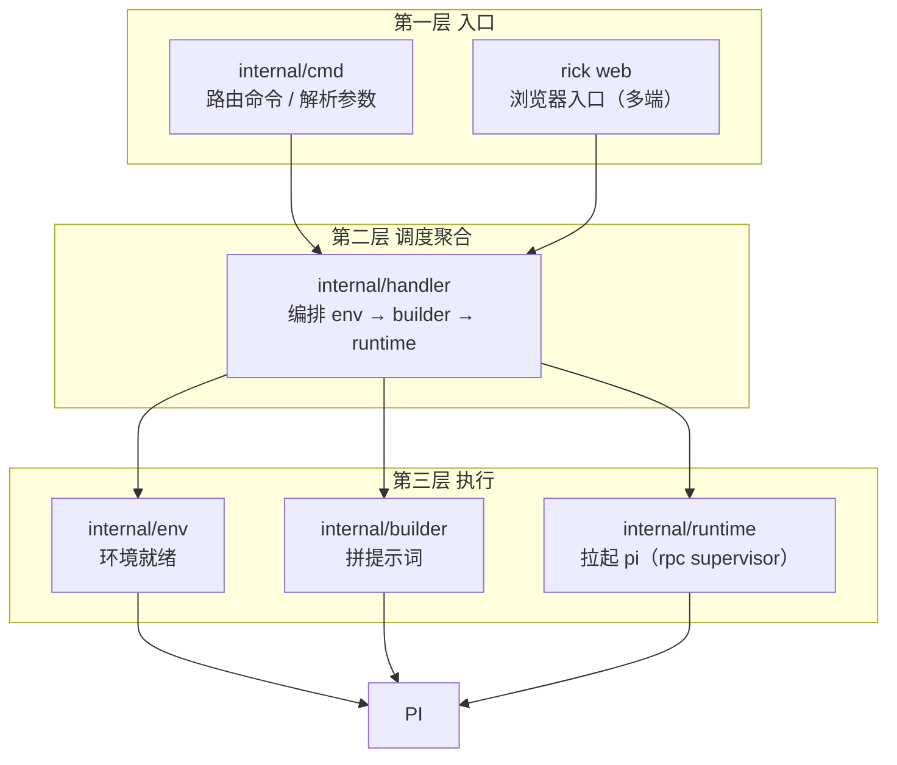

# Rick CLI

> 对抗上下文熵增的 AI Coding 控制框架



---

## 设计哲学

随着项目迭代，软件复杂性逐渐升高，这种复杂性表现为上下文的熵增——AI agent 在执行过程中积累的信息散落在对话历史、临时文件、个人记忆中，无法被结构化复用，导致后续的 AI coding 越跑越乱、越跑越不准。Rick 的核心公式是 `AICoding = Humans + Agents`，其中 `Agents = Models + Harness`，Harness 即上下文。一切设计都围绕上下文的生命周期展开：如何采集、如何压缩、如何复用、如何让它随项目演化保持整洁。

Rick 将上下文分为两个维度。**执行维度**承载"怎么做"的操作性知识：`loops` 是带验收标准的可复用工作流（如 TDD 的红绿重构循环），`skills` 是触发条件明确的原子能力（如"修改 Go 源文件后必须验证编译通过"）。**价值维度**承载"是什么"的描述性知识：`domain` 是代码事实的客观描述（命令规范、架构、编码约定），可被代码验证；`draft` 是个人判断信息的载体（human-loop 思考记录、RFC、未固化的概念探索），不可被代码直接验证。

**skill 单源复用（v4.4 架构原则）**：每个 cmd 的外层阶段模板 = loop（编排节奏 + skill 路径注入 + 变量替换）；内部可复用的实际操作步骤由 skill 承载。所有 section builder 收敛为 prompt 包唯一实现（builder 全委托）。确定性逻辑全部收口 rick-gates hook（门禁/提交/结构校验），Go 侧保持薄。

### pi 作为受控的执行后端

Rick 不直接调用大模型，而是把 [pi](https://pi.dev)（`@earendil-works/pi-coding-agent`）作为执行后端——一个可被 shell 调用的 agent runtime。Rick 自身是**引导程序**：确定性拼装 prompt/文件、注入系统提示词、约束工作流，pi 负责实际的 agentic 执行。

**配置目录隔离**：rick 在 `~/.rick/pi/agent` 下维护专属于自己的 pi 配置（settings、扩展、主题），通过 `PI_CODING_AGENT_DIR` 环境变量注入，与用户自有的 `~/.pi` 完全隔离。用户直接跑 pi 仍用自己的 `~/.pi`；rick 跑 pi 走 `~/.rick/pi`——两套配置互不污染。

---

## 架构：三层金字塔（rick 做薄）



---

## 快速开始

### 安装

```bash
./scripts/install.sh
```

### Web UI（推荐，多端浏览器入口）

在浏览器中操作 rick 的全部核心功能：

```bash
rick web                  # http://127.0.0.1:6137，token 自动生成并打印
```

**Web UI 核心功能**：

| 功能 | 说明 |
|------|------|
| **会话管理** | 新建/恢复/归档会话；全类型会话重命名（任务名） |
| **聊天界面** | 消息流实时渲染（工具调用折叠卡/思考块/通知）；上下文压缩可视化（策略/摘要/token 对比/提示词全文） |
| **Subagent 深度展示** | 工具卡实时进度推送（SSE）；右侧栏只读子会话（完整消息流）；侧边栏活跃 subagent 下拉 |
| **Token/成本监控** | 常驻徽标：会话总消耗（Σ）+ 当前上下文（ctx）+ 成本（$）+ 上下文使用率（百分比+警示） |
| **自动压缩** | 上下文使用率超阈值（默认 80%，可调）自动执行 compact |
| **游标跨设备保留** | 滚动位置存服务端——换设备/刷新恢复到上次阅读位置 |
| **草稿跨设备** | 输入框草稿存服务端（drafts.json）——跨设备不中断 |
| **单 URL 模式** | 页面切换纯内部状态（MemoryRouter），URL 恒定 IP:port/ |
| **懒加载窗口** | 长会话（500+ entries）游标中心窗口快速首屏 + 后台自动补全全量 timeline |
| **文件浏览** | 逐级目录/文件选择器（支持隐藏目录 .rick 等） |
| **知识库浏览** | domain / loops / skills 文件树 + Markdown 渲染 |
| **前端自迭代** | 抽取前端源码到可写层，对话式改造 web 自身 |

详见 [wiki/web-ui.md](wiki/web-ui.md)。

### Easy 模式（白箱，人类把控）

适合探索性任务、快速修复、对话式开发。

```bash
rick easy "帮我修复登录 bug"
rick easy                # 不带需求，进入后输入
rick easy --resume job_5 # 恢复中断的 easy 会话
```

**工作流**：
1. 人类提出需求 → 进入交互式 pi 会话
2. Agent 执行（grilling 追问澄清 → doing loop → learning loop）
3. 退出后人类显式触发 learning（不自动触发）

### Human-Loop 模式（深度思考）

人类与 AI 协同的深度思考会话（SENSE 五阶段），产出 `draft/loops/loop_N/` 思考记录。

```bash
rick human-loop "研究 rick 的知识演化机制"
rick human-loop --resume loop_8  # 恢复思考会话
```

### Dream 模式（跨 job 全局反思）

跨 job 的知识进化（learning 完整性检查 + 演化 loops/domain）。

```bash
rick dream                    # 默认最近 5 个 job
rick dream --job-num 10       # 最近 10 个
```

### Super 模式（自进化环境）

Super mode 提供一个自进化环境（env_N），支持多轮迭代进化（代码生成 → 测试 → 反思 → 改进），通过 web UI 可启动/观察/干预。

```bash
rick super                    # 启动/连接 super 中控会话
```

**Super 环境核心概念**：

| 概念 | 说明 |
|------|------|
| env_N | 自动编号的进化环境（`.rick/super/env_N/`） |
| 进化迭代 | 每轮迭代：代码生成 → 测试评估 → 反思 → 改进方案 → 下一轮 |
| codes/ | 进化产物（当前最佳代码 + 历史版本） |
| events.jsonl | 进化事件流（每轮迭代的完整轨迹） |
| super.json | 环境配置（模型/思考档位/迭代参数） |

**Web UI 中的 Super**：
- 会话列表显示 `SUPER` 徽标 + `env_N` 标识
- 会话页面可启动/观察/干预 super 运行
- 右侧栏可查看子代理实时进度

### Tools（元工具）

```bash
rick tools init-pi           # 安装/更新 pi + 扩展 + 主题
rick tools dev-web up/down   # dev 实例管理（8414 端口）
rick tools release           # 构建+发布到生产
rick tools learning_check    # 学习产出校验
rick tools dream_check       # dream 产出校验
rick tools theme             # 主题管理
```

---

## 命令体系（v6.0.0）

| 命令 | 职责 |
|------|------|
| `rick easy` | 交互式 AI coding（白箱，人类把控） |
| `rick human-loop` | SENSE 五阶段深度思考会话 |
| `rick dream` | 跨 job 全局反思与知识进化 |
| `rick super` | 自进化环境（env_N 中控） |
| `rick web` | Web UI 服务器（多工作区/多端） |
| `rick tools` | 元工具（pi/dev-web/release/check/theme） |

> **v6.0.0 破坏性变更**：删除了 `rick plan`、`rick doing`、`rick learning`、`rick ctrl` 四个命令（CLI + handler + prompt 模板 + builder + web 后端全链路移除）。这些功能现在由 `rick easy`（对话式全流程）和 `rick web`（可视化管理）承载。历史会话数据保留（可打开浏览），但不能再创建新会话。

---

## 双维度知识体系

| 维度 | 载体 | 性质 | 来源 |
|------|------|------|------|
| 执行 | `loops/` | 可复用工作流（带验收标准的迭代控制流） | dream 提炼 |
| 执行 | `skills/` | 原子能力（触发条件 → 执行步骤） | dream / learning 提炼 |
| 价值 | `domain/` | 事实信息（代码/规范/架构的客观描述） | 人类维护 + learning 补充 |
| 价值 | `draft/` | 个人判断（human-loop 思考记录、RFC） | human-loop 产出 |

---

## 会话类型

| 类型 | 说明 | 恢复方式 |
|------|------|----------|
| easy | 交互式 AI coding（白箱） | `rick easy --resume job_N` |
| human-loop | SENSE 深度思考 | `rick human-loop --resume loop_N` |
| dream | 跨 job 反思（后台） | Web UI 恢复 |
| super | 自进化环境 | Web UI 恢复 |

---

## Web UI 截图

（截图待补充——打开 `http://127.0.0.1:6137` 体验）

---

## 开发

```bash
# 构建
go build -o bin/rick ./cmd/rick/

# 前端构建
cd web && npm run build

# 测试
go test ./internal/...
```

---

## License

Private
